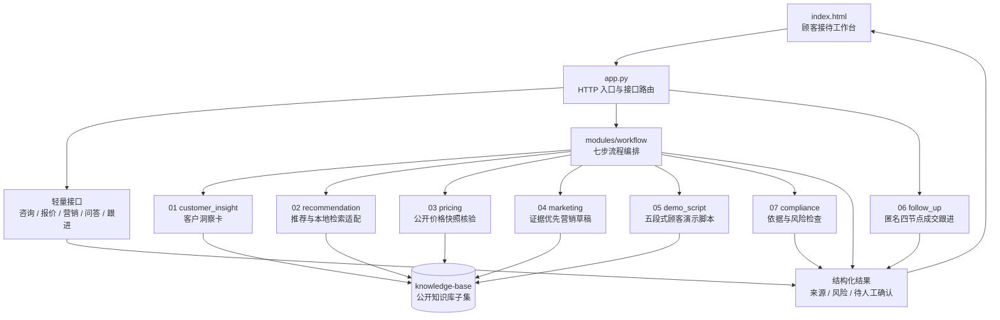

# 门店增长工作台 · 华为 PC 门店销售智能助手

> **先看这里：** 这是一个纯 Python 标准库实现的、证据优先的门店顾客接待工作台。打开本 README 可以先看完整流程图，再从根目录的 `app.py` 启动程序，最后按 `modules/` 中的业务模块阅读实现。

## 30 秒了解项目

- **解决什么问题：** 把需求确认、具体型号推荐、公开价格核验、营销草稿、3 分钟顾客演示脚本、成交跟进和依据合规检查组织成一条可追溯流程。
- **怎么运行：** 不需要 API Key，不需要第三方 Python 包，不需要联网；使用随包分发的公开知识库和确定性规则即可运行。
- **当前边界：** 七步业务环节均有代码实现；演示脚本是可编辑的规则驱动草稿，产品事实带来源，兼容、价格、库存与体验仍须核验。
- **提交入口：** GitHub 当前地址为 `https://github.com/wanhelei1/zhekesong2026`；ModelScope 地址为： https://modelscope.cn/studios/cg12323/zhekesongbisaizuizhong-huawei
- **顾虑记录：** 顾客优先顾虑支持多选，按选择顺序保留优先级，并兼容旧版单值请求。
- **自动化测试：** 47 项测试覆盖推荐、报价、竞品证据门槛、产品对比、未知需求、客户顾虑、演示脚本、跟进和接口契约。

## 先看程序流程

下面的拓扑图展示从浏览器进入 `app.py` 后，如何经过统一流程编排层调用各业务模块，最后回到可审阅的结果。所有需要引用的产品事实、价格和图片来源都来自公开知识库子集；未知项会转为待追问或人工核验。



### 七步业务流程

| 步骤 | 输出 | 当前状态 | 主要实现目录 |
|---|---|---|---|
| 01 客户洞察卡 | 客户身份、场景、需求、顾虑、触发点、沟通策略、依据 | 已实现 | `modules/customer_insight/` |
| 02 推荐方案 | 产品、推荐理由、关键事实、适配程度、来源 | 已实现 | `modules/recommendation/` |
| 03 价格与报价状态 | 配置、公开价格、价格口径、基准日期、来源、待核验项 | 已实现 | `modules/pricing/` |
| 04 营销内容 | 平台、策略、标题、正文、行动引导、图片来源 | 已实现 | `modules/marketing/` |
| 05 3 分钟演示脚本 | 开场、需求确认、产品演示、异议处理、收口 | 已实现 | `modules/demo_script/`；180 秒规则驱动草稿，事实带出处，未知项待核验 |
| 06 成交跟进 | 今天、第 1 天、第 3 天、第 7 天 | 已实现 | `modules/follow_up/` |
| 07 依据与合规 | 引用来源、风险、待人工确认项 | 已实现 | `modules/compliance/` |

## 差异化能力与证据边界

这不是把模型回答直接展示给店员的通用问答工具，而是把门店接待中容易产生错误承诺的环节，拆成有来源、可复核、可保留不确定性的业务节点。

| 能力 | 差异化实现 | 不做的事情 |
|---|---|---|
| 严格竞品价格优势比较 | 仅在华为与友商的 SKU、处理器、内存、存储、已核验官方商城页面价和同口径跑分证据齐全时，才输出“便宜多少” | 不以参数相近、系列名称或未核验第三方价格推断节省金额 |
| 证据优先推荐 | 只有可追溯的 P1 `产品事实.md` 事实可标为“已核验”并进入推荐理由；历史营销素材只保留为“快照”展示 | 不把历史卖点、来源标题或 URL 当成产品事实，也不让其影响评分 |
| 反向需求约束 | 将“不要 OLED”“不需要触控”等否定表达解析为硬排除条件，并从候选中剔除有来源支持的冲突产品 | 不把被排除的特性当作正向卖点检索或推荐 |
| SKU 级公开报价 | 型号、品牌级输入或多个 SKU 命中时不擅自选择价格；仅唯一、已核验的记录可展示金额 | 不把模糊输入映射到临近型号、其他 SKU 或无关的真实价格 |
| 接待到成交的可审阅闭环 | 顾客原话和显式优先顾虑依次驱动洞察、推荐、价格、营销草稿、3 分钟演示、合规提示和匿名四节点跟进 | 不用自动生成的占位语反推顾客偏好，也不收集身份字段建立跟进计划 |
| 事实绑定的内容生成 | 营销图片、产品事实和五段式演示脚本均保存来源；缺少事实时明确保留待核验 | 不生成无来源的产品卖点，不把资料库目录、来源段落或 URL 提炼为卖点 |
| 不确定性管理 | 兼容性、库存、促销、补贴、成交价和体验均保持为待核验项，并由合规模块提示风险 | 不从硬件规格推断软件/外设兼容性，不承诺实时价格、库存或销售效果 |

### 严格竞品价格优势比较

竞品比较是价格模块的受控结论，而不是价格抓取或通用比价。`modules/pricing/pricing_module.py` 只在下列条件**全部满足**时返回友商节省结果；任何一项缺失、冲突或不满足均返回空数组 `[]`：

1. 华为与友商均有状态为“已核验”的**官方商城页面价**，并同时提供精确 SKU、处理器、内存、存储、来源标题和 HTTPS 页面 URL。
2. 友商价格来源只接受 Apple、Samsung、vivo 的官方域名；其他品牌、聚合站、经销商站和第三方电商页面全部拒绝。
3. 两侧必须是同一产品类别，内存和存储容量一致；屏幕尺寸同时提供时差异不得超过 1.5 英寸。
4. 两侧必须有已核验、可追溯的跑分来源，且跑分项目、版本、单位完全一致。
5. 两侧跑分差异不得超过 10%，价格快照日期间隔不得超过 31 天。
6. 只有友商价格**严格高于**华为时才生成“便宜多少”的结论；友商更便宜、价格相等或缺少证据时一律返回 `[]`。
7. 新增证据模板 [`竞品可比配置价格与性能快照.csv`](knowledge-base/华为PC全板块深度知识库_v7/P1-产品参数库/08-官方公开价格快照/竞品可比配置价格与性能快照.csv)。模板目前只有字段表头，不包含任何未经核验的竞品数据，因此生产环境默认不展示友商节省结论。

## 快速运行

### 环境要求

- Python **3.10+**
- 只使用 Python 标准库
- 无需 `pip install`，无需 API Key

### 本地启动

```bash
# Windows
py -3 app.py

# macOS / Linux
python3 app.py
```

浏览器打开 <http://127.0.0.1:7860>。托管环境使用：

```bash
python3 app.py --host 0.0.0.0 --port 7860
```

### Docker 启动

```bash
docker build -t store-growth-workbench .
docker run --rm -p 7860:7860 store-growth-workbench
```

### 自动化测试

```bash
py -3 -m unittest discover -s tests -v
```

## 评委演示路径

1. 启动程序，进入「顾客接待」。
2. 选择「门店零售」，点击示例输入。
3. 点击「生成接待方案与价格核验」。
4. 重点查看客户洞察、推荐依据、价格核验日期、营销草稿和合规待确认项。
5. 点击「查看生成的 3 分钟演示脚本」，检查五段话术及产品事实出处；也可从侧栏独立生成。
6. 再进入「知识问答」和「成交跟进」，查看本地检索来源与匿名四节点计划。

## 接口入口

| 方法 | 路径 | 用途 |
|---|---|---|
| GET | `/health` | 服务健康检查 |
| GET | `/api/bootstrap` | 前端初始化数据 |
| POST | `/api/insight` | 生成客户洞察卡 |
| POST | `/api/recommendation` | 根据客户需求返回有证据支持的具体型号与待确认项 |
| POST | `/api/workflow` | 串联洞察、推荐、价格、营销、演示脚本和合规 |
| POST | `/api/consult` | 轻量顾客接待结果 |
| POST | `/api/knowledge-query` | 本地知识片段检索 |
| POST | `/api/quote` | 公开价格快照与核验状态 |
| POST | `/api/marketing` | 生成营销内容草稿 |
| POST | `/api/demo-script` | 生成五段式顾客演示脚本 |
| POST | `/api/followups/plan` | 创建四节点跟进计划 |
| POST | `/api/followups/task` | 更新单个跟进节点 |
| POST | `/api/followups/status` | 更新计划状态 |

## 仓库阅读顺序

根目录按“先运行、再理解、后深入”的顺序组织：

```text
.
├── README.md                  # 第一入口：流程图、运行、结构和边界
├── app.py                    # 主程序：HTTP 服务、接口路由、静态页面服务
├── index.html                # 前端工作台
├── Dockerfile                # ModelScope / Docker 启动配置
├── prepare_public_deploy.py  # 生成排除受限资料的公开部署包
├── modules/                  # 按业务职责拆分的 Python 模块
│   ├── README.md             # 模块总览和调用关系
│   ├── workflow/             # 流程编排层
│   ├── customer_insight/     # 01 客户洞察
│   ├── recommendation/       # 02 推荐与检索适配
│   ├── pricing/              # 03 价格快照核验
│   ├── marketing/            # 04 营销草稿
│   ├── demo_script/          # 05 三分钟顾客演示脚本
│   ├── follow_up/            # 06 成交跟进
│   └── compliance/           # 07 依据与合规
├── tests/                    # 自动化测试和测试说明
├── docs/                     # 需求、系统设计、演示与测试文档
└── knowledge-base/           # 公开知识库子集及其说明
```

每个模块目录都包含自己的 `README.md`，说明职责、文件、入口函数、输入输出和验证方式。建议按以下顺序阅读：

1. [modules/workflow/](modules/workflow/)：先看跨模块如何串联。
2. [modules/customer_insight/](modules/customer_insight/) 和 [modules/recommendation/](modules/recommendation/)：理解客户需求与推荐依据如何形成。
3. [modules/pricing/](modules/pricing/)、[modules/marketing/](modules/marketing/)、[modules/demo_script/](modules/demo_script/) 和 [modules/compliance/](modules/compliance/)：理解价格、内容、顾客演示和合规边界。
4. [modules/follow_up/](modules/follow_up/)：查看匿名跟进计划的数据结构和状态流转。
5. [tests/](tests/)：用测试确认接口和跨模块契约。

## 模块职责

| 目录 | 核心文件 | 作用 |
|---|---|---|
| `modules/workflow/` | `store_growth_workflow.py` | 统一装配洞察、推荐、价格、营销、演示脚本和合规结果 |
| `modules/customer_insight/` | `kb_agent.py` | 从显式顾客输入生成洞察卡和待追问项 |
| `modules/recommendation/` | `recommendation_engine.py`、`retrieval_adapter.py`、`mock_retriever.py` | 本地 Mock 检索、推荐候选和硬条件评估 |
| `modules/pricing/` | `pricing_module.py` | 读取官方公开价格快照，区分金额、日期和人工核验项 |
| `modules/marketing/` | `marketing_content_module.py` | 依据 P2/P6 素材生成可审阅营销草稿 |
| `modules/demo_script/` | `demo_script_module.py` | 生成五段式顾客演示草稿，产品事实附来源和行号 |
| `modules/follow_up/` | `follow_up_module.py` | 生成今天、第 1 天、第 3 天、第 7 天匿名跟进计划 |
| `modules/compliance/` | `block07_compliance.py` | 检查绝对化、价格促销、无依据比较、虚构体验等风险 |

## 证据与数据边界

- 推荐结论必须能回到知识库事实；未知或冲突不会自动判定为满足。
- 价格只展示带核验日期的官方公开快照，不代表当前库存、促销、地区价或成交价。
- 友商价格优势只在 `竞品可比配置价格与性能快照.csv` 提供完整、可追溯的官方价格、SKU、硬件和同口径跑分证据，且友商价格严格高于华为时输出；缺任一条件即不输出比较或节省金额。
- 软件和外设兼容性不从硬件参数推断，必须按目标版本和现场环境核验。
- 营销内容是草稿；合规检查通过不等于可以直接发布，仍需人工审核。
- 本地知识问答是明确标注的 Mock 精选检索，不是生产级全库搜索，也未接入外部 LLM。
- 公开包不包含 P4 价格政策、待审核资料、历史归档和来源研究底稿。

## ModelScope Docker 部署

公开演示空间：[ModelScope 魔搭空间](https://modelscope.cn/studios/cg12323/zhekesongbisaizuizhong-huawei)。该空间使用自定义 `serve.py` 处理网关探测，并由 Dockerfile 将 LFS 管理的 `app.pkg` 解压到 `/app`；更新时保留现有 `serve.py` 与 Dockerfile，只替换筛选后的应用归档。

从完整开发目录生成新的公开部署包时，指定一个尚不存在的输出目录：

```powershell
py -3 prepare_public_deploy.py --output dist/public-deploy-new
```

脚本会自动排除受限知识库目录，并生成 `bundle-manifest.json`。部署前应核对清单并在无痕窗口验证真实空间。

## 已知局限与下一步

1. 本地检索使用确定性关键词排序和精选片段，下一步可扩展全库索引与相关性调优。
2. 价格模块不接入动态促销、库存、补贴或授权折扣。
3. 演示脚本为确定性规则生成，缺少匹配事实时保持待核验；不能替代 SKU、兼容性、实时商业信息或现场体验确认。
4. 未使用真实门店成交或转化样本，不声明销售提升、ROI 或客户案例效果。

## 团队

浙客松·AI+X 破界黑客松 · 华为产业落地赛道

| 角色 | 成员 | 职责 |
|---|---|---|
| 1号 · 组长 | 雷秉谕 | 需求拆解 / 规格文档 / 验收 / 答辩 |
| 2号 · 开发 | 姜宇翔 | 核心程序 / 接口 |
| 3号 · 界面与部署 | 程塨 | 工作台界面 / 魔搭部署 |
| 4号 · 测试与仓库 | 巩志栋 | 测试用例 / 文档 / 提交 |

## 许可证

见 [LICENSE](LICENSE)。
