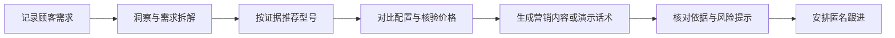

# 门店增长工作台 · 华为产品顾客接待助手

> 面向门店顾问的一站式产品接待工作台：从顾客需求记录、产品推荐和配置对比，到价格依据、可直接使用的营销内容、三分钟演示话术与匿名跟进，让每一步都清晰、易读、可核验。

[](https://github.com/wanhelei1/zhekesong2026) · [ModelScope 在线演示](https://modelscope.cn/studios/cg12323/zhekesongbisaizuizhong-huawei)

## 产品亮点

### 一张工作台，覆盖从接待到跟进

围绕门店顾客的实际接待流程，把需求洞察、推荐、报价信息、内容生成、产品演示、合规依据和成交跟进整合在同一界面。顾问可按具体任务单独使用模块，也可串起完整接待流程。



### 让产品差异一目了然

选择两款已有本地规格依据的产品，即可按相同字段并排查看操作系统、屏幕、处理器、内存、存储、尺寸与重量、电池、接口、摄像头及特色应用。系统标出相同项、不同项与资料未提供项，并保留产品依据入口，方便顾客快速聚焦差异。

### 少填信息也能开始推荐

顾问可从顾客角色、使用场景、预算、主要任务和优先顾虑等信息开始；需求尚不完整时，仍可查看候选。候选按相对匹配优先级排序，结合已核验事实、已确认条件和待确认问题展示推荐理由。排序分值用于区分候选先后，不代表统计概率或质量保证。

### 把证据带到顾客面前

产品事实、价格快照、图片与建议内容均保留来源线索。顾客界面以简洁的“官方产品依据”等入口呈现，不暴露本地文件路径、行号和内部来源标识；开发与接口数据仍保留必要的追溯信息。未知事项以清晰状态展示，不把未知写成已确认事实。

### 可直接使用的内容与演示话术

- **营销内容：** 根据产品、平台、受众和目标生成标题、正文、行动引导及适配图片建议；正文可复制使用，并附产品依据与需要留意的信息。
- **三分钟演示：** 按顾客情境组织开场、需求确认、产品展示、异议回应和收口五段内容；每段提供对客表达和现场动作提示，可查看官方产品页面。
- **价格说明：** 展示有来源的价格快照、配置与核验日期，帮助顾问区分公开页面信息和门店实际交易条件。
- **竞品比较：** 仅当型号、SKU、官方价格、配置与同口径性能依据等条件相符时呈现价格优势结论，并提供可追溯依据。

### 更清晰、适合门店现场阅读

界面采用金色渐变背景与深蓝操作元素，产品差异表格、圆角栏目及卡片化信息便于扫读；正文、表单、状态与依据文字使用加大字号，桌面和移动窗口均可查看。

## 差异化设计

| 常见风险 | 工作台的处理方式 |
|---|---|
| 信息不完整却直接给出确定结论 | 可用部分画像开始推荐；相对排序与已核验事实、待确认事项一并展示 |
| 参数混在长段落里，不便比较 | 使用统一规格字段并排展示，并明确标出相同、不同和资料未提供 |
| 推荐或文案无法追溯依据 | 保留产品来源和官方页面入口；界面隐藏技术性内部定位信息 |
| 将快照价格当成当前成交价 | 标明价格口径与核验日期，并将公开页面信息和实际交易条件区分 |
| 把历史卖点或假设包装成产品事实 | 推荐与内容围绕可追溯产品资料；对不确定信息保留核验提示 |
| 跟进流程依赖收集顾客个人信息 | 使用匿名线索和本地四节点跟进计划，不要求录入姓名、手机号等身份字段 |

## 模块一览

| 模块 | 能力 |
|---|---|
| 顾客洞察 | 整理顾客角色、任务、使用情境、优先顾虑及后续确认问题 |
| 产品推荐 | 根据需求和条件检索有依据的型号候选，展示相对匹配顺序与核验要点 |
| 配置对比 | 从本地产品事实矩阵选取两款产品，逐项展示配置差异和依据 |
| 价格核验 | 展示公开价格快照、配置、来源及核验日期 |
| 营销内容 | 生成面向不同平台和人群的标题、可发布正文、行动引导及图片建议 |
| 顾客演示 | 生成可照着讲的五段式三分钟演示内容，并提供官方依据入口 |
| 成交跟进 | 创建今天、第 1 天、第 3 天、第 7 天四个节点的匿名跟进计划 |
| 知识问答与合规 | 基于本地精选资料回答，并提示依据与内容核验关注点 |

## 快速启动

### 环境要求

- Python 3.10 或更高版本
- 使用 Python 标准库，无需安装第三方 Python 包
- 本地运行无需 API Key

### Windows

```powershell
py -3 app.py
```

### macOS / Linux

```bash
python3 app.py
```

启动后访问 <http://127.0.0.1:7860>。

### Docker

```bash
docker build -t store-growth-workbench .
docker run --rm -p 7860:7860 store-growth-workbench
```

## 测试

```bash
py -3 -m unittest discover -s tests -v
```

当前测试集覆盖 HTTP 接口、顾客需求与推荐、配置对比、价格证据门槛、营销内容、演示脚本、成交跟进及跨模块工作流。

## 接口速览

| 方法 | 路径 | 用途 |
|---|---|---|
| GET | `/health` | 服务健康检查 |
| GET | `/api/bootstrap` | 前端初始化数据、产品及配置 |
| POST | `/api/insight` | 顾客需求洞察 |
| POST | `/api/recommendation` | 返回需求候选与推荐依据 |
| POST | `/api/product-compare` | 并排对比两款产品的本地规格 |
| POST | `/api/quote` | 查询价格快照与核验状态 |
| POST | `/api/marketing` | 生成营销内容与图片建议 |
| POST | `/api/demo-script` | 生成五段式顾客演示话术 |
| POST | `/api/knowledge-query` | 查询本地知识片段 |
| POST | `/api/workflow` | 运行完整接待工作流 |
| POST | `/api/followups/plan` | 创建四节点跟进计划 |
| POST | `/api/followups/task` | 更新跟进节点 |
| POST | `/api/followups/status` | 更新跟进计划状态 |

## 项目结构

```text
.
├── app.py                    # HTTP 服务与接口路由
├── index.html                # 门店顾客接待工作台
├── Dockerfile                # Docker / 演示环境启动配置
├── modules/
│   ├── workflow/             # 跨模块业务编排
│   ├── customer_insight/     # 顾客需求洞察
│   ├── recommendation/       # 推荐与检索适配
│   ├── pricing/              # 价格快照核验
│   ├── marketing/            # 营销内容生成
│   ├── demo_script/          # 三分钟顾客演示
│   ├── follow_up/            # 匿名成交跟进
│   └── compliance/           # 依据与风险检查
├── tests/                    # 自动化测试
├── docs/                     # 需求、设计、演示与测试文档
└── knowledge-base/           # 产品知识库与规格事实矩阵
```

## 演示与部署

- **在线演示：** [ModelScope 魔搭空间](https://modelscope.cn/studios/cg12323/zhekesongbisaizuizhong-huawei)
- **GitHub 仓库：** [wanhelei1/zhekesong2026](https://github.com/wanhelei1/zhekesong2026)
- **公开部署包：** 使用 `prepare_public_deploy.py` 生成仅包含公开资料的部署目录，并按脚本生成的清单检查发布内容。

## 团队与许可

浙客松 · AI+X 破界黑客松 · 华为产业落地赛道

| 角色 | 成员 | 职责 |
|---|---|---|
| 1号 · 组长 | 雷秉谕 | 需求拆解 / 规格文档 / 验收 / 答辩 |
| 2号 · 开发 | 姜宇翔 | 核心程序 / 接口 |
| 3号 · 界面与部署 | 程塨 | 工作台界面 / 魔搭部署 |
| 4号 · 测试与仓库 | 巩志栋 | 测试用例 / 文档 / 提交 |

许可证见 [LICENSE](LICENSE)。

## 迭代日志

### 2026-10-22 · 推荐、证据呈现与阅读体验升级

- 推荐支持从部分顾客画像、场景、预算或需求开始，按相对优先级呈现候选，不把排序分值描述成概率。
- 推荐结果、营销内容和演示话术使用面向顾客的产品依据入口；内部路径、行号和来源标识不出现在顾客展示文案中，接口仍保留追溯信息。
- 营销模块提供可直接使用的正文和 `publish_ready` 状态，保留产品依据、图片来源和动态信息提示。
- 调整整体字号及重点标题、状态和表格文字大小，提升门店阅读体验，同时保持现有功能与内容。

### 2026-10-21 · 配置对比与演示流程优化

- 新增产品配置对比工作区：两款产品按统一字段并排展示，突出差异并提供产品依据入口。
- 简化顾客信息录入，以选项为主记录角色、预算、顾虑、软件和外设需求，特殊情况再补充说明。
- 优化三分钟演示脚本的五段结构、现场展示提示和官方产品依据链接，支持接待信息带入演示流程。
- 完善对比、演示和顾客工作流相关接口及回归测试。
